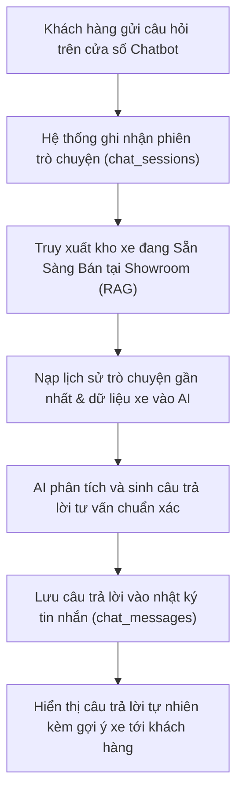
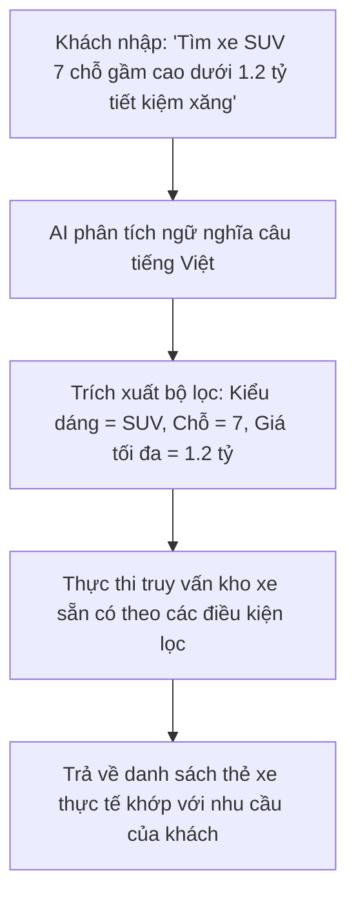
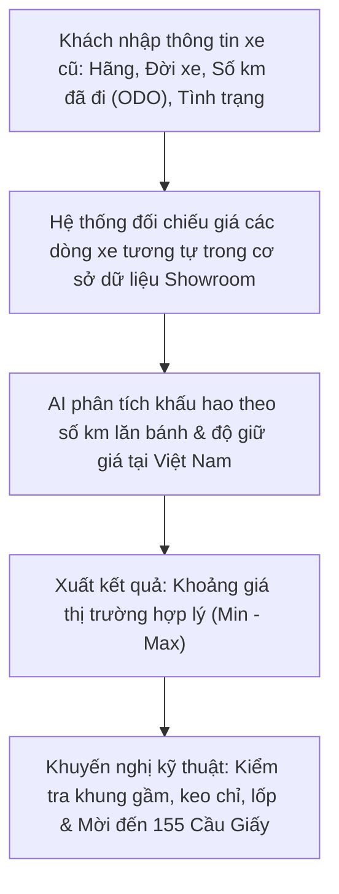
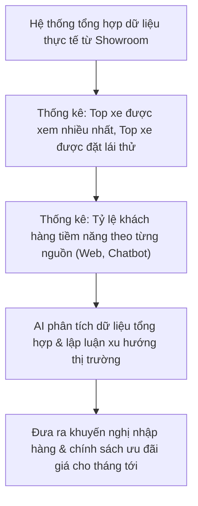

# Đặc Tả Hoạt Động Của Trí Tuệ Nhân Tạo (AI) Trong Website Showroom Ô Tô SkyCar

---

## 1. Tổng Quan Về Hệ Thống AI Tại Showroom SkyCar

Hệ thống **Website Showroom Ô Tô SkyCar** (155 Cầu Giấy, Hà Nội) tích hợp phân hệ **Trí tuệ nhân tạo (AI Core)** nhằm nâng cao trải nghiệm khách hàng và tối ưu hiệu suất bán xe của đội ngũ nhân viên.

Khác với các chatbot trả lời chung chung, AI tại SkyCar được thiết kế theo cơ chế **Truy xuất thông tin thực tế kết hợp tạo sinh (Retrieval-Augmented Generation - RAG)**. Điều này giúp AI am hiểu chính xác **kho xe thực tế** đang có tại showroom (giá niêm yết, thông số kỹ thuật, số chỗ ngồi, tình trạng sẵn bán) để đưa ra câu trả lời chân thực và đáng tin cậy.

Hệ thống hỗ trợ linh hoạt 3 chế độ vận hành qua mô hình kiến trúc **Factory Pattern**:
- **Google Gemini (`gemini-2.0-flash`):** Tốc độ phản hồi cực nhanh, khả năng hiểu tiếng Việt tự nhiên và trích xuất ý định xuất sắc.
- **OpenAI (`gpt-4o-mini`):** Độ chính xác cao trong đối thoại và phân tích dữ liệu thị trường.
- **Mock AI Cố Vấn Tự Động (Offline Engine):** Tự động kích hoạt khi chưa cấu hình API key, đảm bảo website luôn hoạt động 100% trơn tru không bao giờ bị lỗi kết nối.

---

## 2. Danh Mục 5 Chức Năng AI Hoạt Động Trong Hệ Thống

| Tính Năng AI | Tác Nhân Sử Dụng | Mục Đích Nghiệp Vụ Thực Tế | Cơ Chế Hoạt Động |
| :--- | :--- | :--- | :--- |
| **1. Trợ Lý Ảo Bán Xe (AI Chatbot Advisor)** | Khách vãng lai & Khách thành viên | Trò chuyện, tư vấn chọn xe theo tầm giá, giải thích thông số kỹ thuật 24/7 | RAG lấy trực tiếp dữ liệu kho xe thực tế tại showroom nạp vào ngữ cảnh trò chuyện; lưu vết phiên chat. |
| **2. Tìm Kiếm Bằng Ngôn Ngữ Tự Nhiên** | Khách xem xe trên trang chủ | Giúp khách gõ câu tự nhiên (VD: *"Tìm xe SUV 7 chỗ dưới 1 tỷ"*) để tìm xe ngay | Trích xuất thông tin người dùng nhập thành bộ lọc có cấu trúc và truy vấn kho xe phù hợp. |
| **3. Gợi Ý Xe Thông Minh (Smart Recommendation)** | Khách hàng có nhu cầu mua xe | Đề xuất danh sách xe tối ưu theo ngân sách, số chỗ ngồi và phong cách sử dụng | Thuật toán đối sánh đa tiêu chí kết hợp lời giải thích vì sao xe phù hợp với khách. |
| **4. Thẩm Định & Định Giá Xe Cũ (Valuation)** | Khách hàng có nhu cầu đổi xe cũ lên đời | Định giá xe đã qua sử dụng dựa trên năm sản xuất, ODO (số km đã đi) và tình trạng xe | So sánh giá các mẫu xe tương đương trong cơ sở dữ liệu showroom kết hợp đánh giá tỷ lệ giữ giá thị trường. |
| **5. Cố Vấn Chiến Lược Kinh Doanh (AI Insights)** | Quản trị viên (Anh Duy) & Seller | Đánh giá xu hướng thị hiếu khách hàng, hiệu quả chuyển đổi và gợi ý nhập xe | Tổng hợp dữ liệu lượt xem, lịch lái thử, nguồn khách tiềm năng để đưa ra nhận định kinh doanh. |

---

## 3. Sơ Đồ Quy Trình Hoạt Động Chi Tiết Của Từng Chức Năng AI

### 3.1 Quy Trình Hoạt Động Của Trợ Lý Ảo AI Tư Vấn (AI Chatbot)

#### Giải thích nguyên lý:
1. **Lưu vết hội thoại:** Khách vãng lai hay khách đăng nhập đều được tạo một phiên trao đổi (`session`), giúp AI ghi nhớ được các câu hỏi trước đó của khách để trả lời liền mạch.
2. **Kho xe thực tế:** Trước khi trả lời, hệ thống tự động lấy danh mục các mẫu xe đang có trong showroom để gửi kèm vào bối cảnh của AI. Nhờ đó, AI không nói sai về giá hoặc tư vấn xe mà showroom không có.
3. **Phản hồi tức thì:** Phản hồi của AI mang tính tư vấn chuyên nghiệp, khuyến khích khách hàng đăng ký lái thử hoặc để lại số điện thoại cho Seller hỗ trợ.

---

### 3.2 Quy Trình Tìm Kiếm Xe Bằng Ngôn Ngữ Tự Nhiên (Natural Language Search)

#### Giải thích nguyên lý:
- Thay vì bắt khách hàng phải tự bấm chọn từng ô lọc (hãng, kiểu dáng, mức giá), khách chỉ cần gõ đúng nhu cầu như khi nói chuyện với nhân viên showroom.
- Hệ thống AI tự động bóc tách các con số ("1.2 tỷ" ➔ 1.200.000.000 VNĐ) và các thuật ngữ kiểu dáng ("SUV", "Sedan") để lọc dữ liệu chính xác.

---

### 3.3 Quy Trình Thẩm Định & Định Giá Xe Đã Qua Sử Dụng (Valuation)

Khách hàng muốn bán xe cũ để lên đời xe mới tại Showroom SkyCar có thể sử dụng chức năng định giá:

#### Các tiêu chí AI thẩm định:
* **Hãng xe và thương hiệu:** Tỷ lệ giữ giá của các dòng xe Nhật, Hàn, Đức tại thị trường Việt Nam.
* **Số km lăn bánh (ODO):** Khấu hao trung bình tính theo quãng đường đã chạy thực tế.
* **Tình trạng thân vỏ và động cơ:** Đánh giá ảnh hưởng của mức độ sử dụng đến giá trị bán lại.

---

### 3.4 Quy Trình Phân Tích Xu Hướng Thị Hiếu Cho Quản Trị & Seller (AI Executive Insights)

Dành riêng cho **Anh Duy** (Quản trị viên) và **Seller** trong phân hệ quản trị (`/admin/ai`):

#### Báo cáo mang lại giá trị gì cho Showroom?
1. **Biết khách hàng đang thích dòng xe nào:** Dự báo nhu cầu thị trường để nhập đúng chủng loại xe bán chạy.
2. **Đánh giá hiệu quả phễu bán hàng:** Phân tích xem lượt xem xe có chuyển đổi tốt sang lượt đặt lịch lái thử hay không.
3. **Định hướng khuyến mãi:** Gợi ý dòng xe nào nên áp dụng mã voucher giảm giá để kích cầu tồn kho.

---

## 4. Bảng Phân Quyền Khai Thác Chức Năng AI

| Tính Năng AI | Khách Vãng Lai | Khách Thành Viên | Nhân Viên (Seller) | Quản Trị Viên (Anh Duy) |
| :--- | :---: | :---: | :---: | :---: |
| Trò chuyện cùng AI Chatbot | Có (Lưu theo phiên tạm) | Có (Lưu lịch sử tài khoản) | Có | Có |
| Tìm kiếm xe bằng ngôn ngữ tự nhiên | Có | Có | Có | Có |
| Nhận gợi ý xe theo ngân sách | Có | Có | Có | Có |
| Định giá xe cũ đã qua sử dụng | Có | Có | Có | Có |
| Xem phân tích kinh doanh (AI Insights) | Không | Không | **Có** | **Có** |
| Cấu hình chìa khóa API & Nhà cung cấp AI | Không | Không | Không | **Có** |

---

## 5. Kết Luận & Ý Nghĩa Nghiệp Vụ

Sự hiện diện của hệ thống AI trong Website Showroom SkyCar mang lại 3 giá trị thiết thực:
1. **Phục vụ khách hàng không gián đoạn:** Giải đáp thắc mắc về xe tức thì bất kể ngày đêm, hỗ trợ khách từ khâu tìm hiểu đến khi sẵn sàng đến showroom 155 Cầu Giấy lái thử.
2. **Giảm tải cho đội ngũ Seller:** Khách hàng đến showroom đã nắm rõ các thông số và tầm giá nhờ AI giải thích trước, giúp Seller chốt đơn nhanh hơn.
3. **Hỗ trợ Quản trị viên (Anh Duy) ra quyết định bằng số liệu:** Không dựa vào cảm tính mà dựa trên dữ liệu tương tác thực tế của khách hàng trên website.
