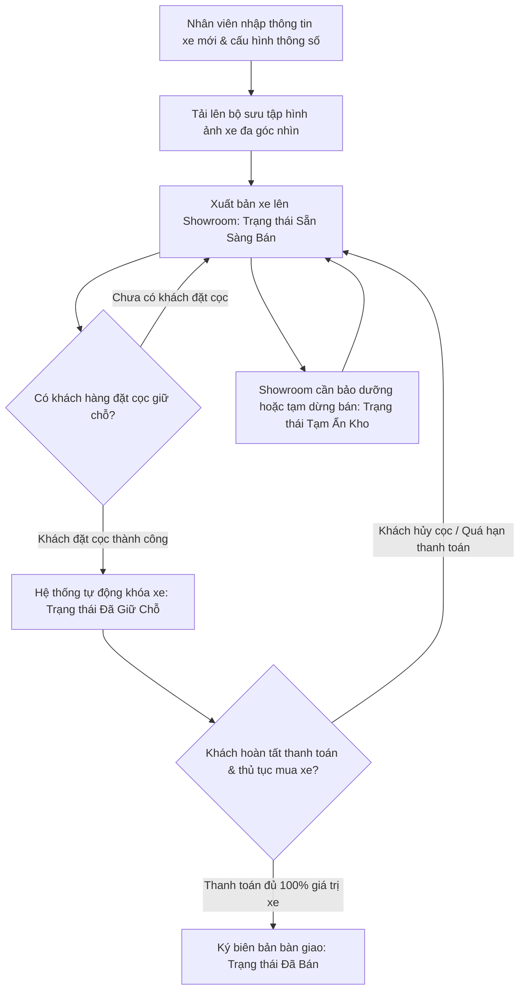
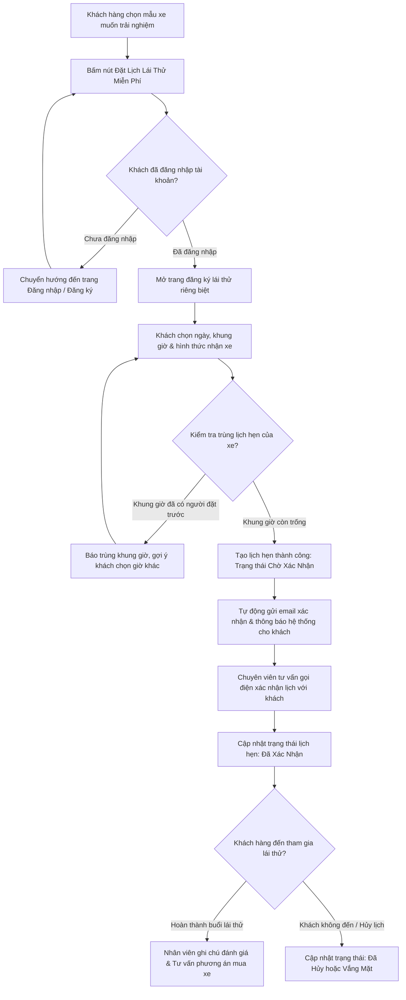
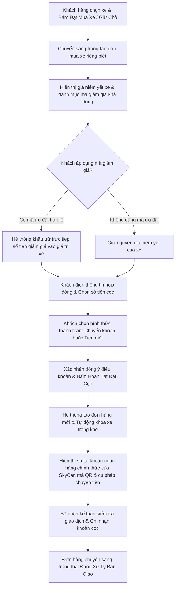
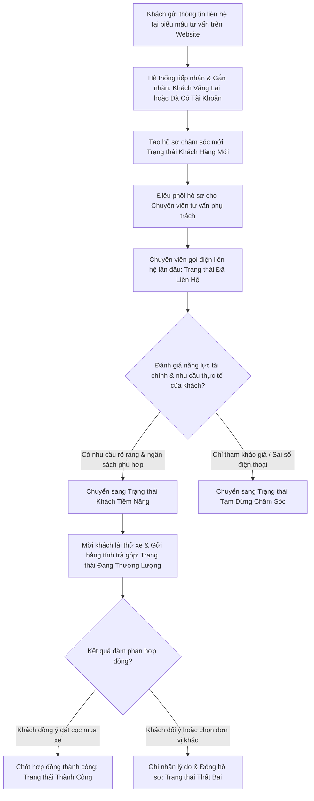
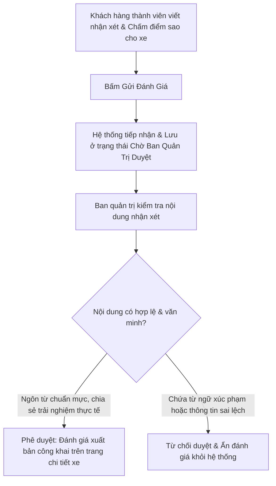

# Phân Tích Hướng Nghiệp Vụ Hệ Thống Showroom Ô Tô SkyCar (Business Analysis Document)

---

## 1. Tổng Quan Về Website Showroom Ô Tô SkyCar
**SkyCar** là hệ thống website dành riêng cho **Showroom Ô Tô SkyCar** (địa chỉ tại 155 Cầu Giấy, Hà Nội). Hệ thống đóng vai trò là cầu nối số hóa giữa khách hàng và showroom trưng bày xe, bao gồm 2 phân hệ cốt lõi:
1. **Cổng thông tin khách hàng (Public & Customer Portal):** Nơi khách hàng vãng lai và khách hàng đã đăng ký có thể dễ dàng tìm kiếm, lọc xe theo ngân sách, đối chiếu so sánh thông số kỹ thuật các mẫu xe đang có tại showroom, gửi thông tin yêu cầu tư vấn, đăng ký lịch hẹn lái thử xe và tiến hành đặt cọc giữ xe trực tuyến an toàn.
2. **Phân hệ điều hành nội bộ Showroom (Admin & Seller Portal):** Nơi Quản trị viên (Anh Duy) và đội ngũ nhân viên kinh doanh (Seller) theo dõi kho xe thực tế, tiếp nhận và điều phối lịch hẹn lái thử, quản lý đơn cọc giữ chỗ, chăm sóc khách hàng tiềm năng qua phễu CRM và theo dõi báo cáo doanh thu kinh doanh của showroom.

### 1.1 Mục Tiêu Xây Dựng Hệ Thống
- **Minh bạch hóa kho xe showroom:** Trưng bày đầy đủ hình ảnh thực tế đa góc nhìn, bảng thông số kỹ thuật chi tiết, giá bán niêm yết và trạng thái sẵn sàng giao ngay của từng chiếc xe trong showroom theo thời gian thực.
- **Tiện ích hóa hành trình mua xe của khách:** Giúp khách hàng chủ động tìm kiếm xe theo nhu cầu và ngân sách, trải nghiệm lái thử thuận tiện tại nhà hoặc tại showroom, và đặt cọc online nhanh chóng với mã giảm giá ưu đãi.
- **Chuẩn hóa quy trình vận hành và bán hàng:** Thu thập yêu cầu tư vấn từ khách, phân công cho Seller phụ trách chăm sóc, quản lý chặt chẽ việc duyệt cọc giữ chỗ và ngăn chặn triệt để tình trạng trùng lịch lái thử.
- **Thiết kế kiến trúc hướng dịch vụ (SOA):** Phân chia rõ ràng thành các tầng dịch vụ nghiệp vụ độc lập, giúp hệ thống vận hành ổn định, dễ dàng bảo trì và mở rộng trong tương lai.

---

## 2. Mô Hình Tác Nhân & Phân Định Trách Nhiệm

Hệ thống SkyCar phân chia rõ ràng trách nhiệm của 4 nhóm tác nhân:

| Tác nhân | Phạm vi hoạt động | Quyền hạn & Trách nhiệm chính |
| :--- | :--- | :--- |
| **Khách Vãng Lai** | Trang công khai | - Tìm kiếm, lọc xe theo tầm giá, thương hiệu, kiểu dáng, loại nhiên liệu. - Xem chi tiết thông số kỹ thuật, hình ảnh xe và định giá thị trường. - Sử dụng công cụ đối chiếu, so sánh giữa nhiều mẫu xe cùng lúc. - Gửi thông tin đăng ký nhận tư vấn miễn phí. - Đăng ký tài khoản thành viên hoặc đăng nhập vào hệ thống. |
| **Khách Hàng Thành Viên** | Trang khách hàng | - Có đầy đủ quyền của Khách vãng lai. - Quản lý hồ sơ cá nhân và cập nhật thông tin liên hệ. - Lưu danh mục các mẫu xe yêu thích. - Đăng ký lịch lái thử xe tại trang riêng biệt, chọn ngày, giờ và địa điểm nhận xe. - Theo dõi tiến độ lịch hẹn; chủ động hủy lịch khi lịch còn ở trạng thái chờ xác nhận. - Đặt cọc giữ xe trực tuyến tại trang riêng, áp dụng mã ưu đãi giảm giá và nhận thông tin hướng dẫn chuyển khoản. - Theo dõi tiến độ đơn hàng và lịch sử các đợt thanh toán cọc. - Gửi đánh giá, nhận xét trải nghiệm xe. *Lưu ý:* Bị chặn hoàn toàn khỏi khu vực quản trị nội bộ của nhân viên. |
| **Nhân Viên Kinh Doanh (Seller)** | Khu vực quản trị nội bộ | - Quản lý kho xe: Thêm xe mới, cập nhật thông số và quản lý bộ sưu tập ảnh xe. - Điều phối lịch hẹn lái thử: Tiếp nhận, liên hệ xác nhận lịch với khách, cập nhật kết quả sau buổi trải nghiệm. - Quản lý đơn cọc xe: Xác nhận khoản tiền cọc khách hàng đã chuyển khoản, theo dõi tiến độ chuẩn bị xe. - Chăm sóc khách hàng tiềm năng: Theo dõi và cập nhật tiến trình tư vấn qua từng giai đoạn của phễu bán hàng. - Kiểm duyệt đánh giá của khách hàng trước khi cho phép hiển thị. - Theo dõi bảng số liệu báo cáo tình hình kinh doanh. |
| **Quản Trị Viên (Anh Duy)** | Toàn quyền hệ thống | - Có toàn bộ quyền hạn của Nhân viên kinh doanh (Seller). - Quản lý tài khoản người dùng: Phân quyền vai trò (Khách hàng, Seller, Quản trị viên), kích hoạt hoặc khóa tài khoản vi phạm. - Xóa bỏ thông tin xe hoặc tạm ẩn xe khỏi danh mục kinh doanh khi cần thiết. - Quản lý chính sách ưu đãi, phát hành mã giảm giá và mức tiền đặt cọc tối thiểu. - Giám sát toàn bộ nhật ký an ninh và lịch sử thay đổi dữ liệu của hệ thống. |

---

## 3. Các Luồng Quy Trình Nghiệp Vụ Cốt Lõi (Workflows)

---

### 3.1 Quy Trình Quản Lý Vòng Đời & Trạng Thái Kho Xe

Quy trình kiểm soát toàn bộ hành trình của một chiếc xe từ khi nhập vào showroom cho đến khi hoàn tất bàn giao cho khách hàng.

#### Các bước triển khai chi tiết:
1. **Khởi tạo hồ sơ xe:** Nhân viên nhập đầy đủ thông số bao gồm hãng sản xuất, dòng xe, năm sản xuất, giá niêm yết, kiểu dáng, nhiên liệu, hộp số, dung tích động cơ và mô tả trang bị nổi bật.
2. **Cập nhật hình ảnh thực tế:** Đăng tải bộ ảnh chất lượng cao và chọn ra một bức ảnh nổi bật nhất để làm ảnh đại diện chính trên trang chủ và danh mục tìm kiếm.
3. **Phát hành công khai:** Khi hồ sơ hoàn tất, xe xuất hiện trên website ở trạng thái *Sẵn sàng bán* để khách hàng có thể tìm kiếm, đăng ký lái thử hoặc đặt cọc.
4. **Khóa giữ chỗ:** Khi có khách hàng đặt cọc thành công, xe lập tức chuyển sang trạng thái *Đã giữ chỗ* nhằm đảm bảo không ai khác có thể đặt cọc trùng vào chiếc xe này.
5. **Hoàn tất bàn giao hoặc mở lại:** 
   - Nếu khách hàng thanh toán đủ tiền xe và hoàn tất thủ tục giấy tờ, xe chuyển sang trạng thái *Đã bán*.
   - Nếu khách hàng hủy giao dịch, chiếc xe sẽ được mở khóa quay trở lại trạng thái *Sẵn sàng bán*.
6. **Lưu trữ lịch sử:** Đối với những xe tạm dừng kinh doanh, hệ thống chuyển sang trạng thái *Tạm ẩn kho* thay vì xóa vĩnh viễn, giúp lưu giữ đầy đủ chứng từ kế toán và lịch sử giao dịch trước đây.

---

### 3.2 Quy Trình Đăng Ký & Điều Phối Lịch Lái Thử Xe

Quy trình hỗ trợ khách hàng trải nghiệm thực tế mẫu xe mong muốn trước khi đưa ra quyết định mua hàng.

#### Các bước triển khai chi tiết:
1. **Lựa chọn trải nghiệm:** Khách hàng bấm nút *“Đặt Lịch Lái Thử Miễn Phí”* tại trang chi tiết của chiếc xe quan tâm.
2. **Xác thực thành viên:** Khách hàng đăng nhập tài khoản để hệ thống tự động điền sẵn Họ tên, Số điện thoại và Email.
3. **Thiết lập thông tin lịch hẹn:**
   - Khách chọn ngày lái thử (quy định chọn từ ngày kế tiếp trở đi).
   - Chọn khung giờ phù hợp (các mốc thời gian buổi sáng hoặc buổi chiều).
   - Chọn hình thức trải nghiệm: Nhận xe tại Showroom SkyCar hoặc Đưa xe đến tận nhà riêng của khách.
   - Điền số Giấy phép lái xe và yêu cầu đặc biệt về lộ trình lái thử.
4. **Kiểm tra tự động chống trùng lặp:** Hệ thống tự động rà soát xem chiếc xe đó đã có ai đặt trước vào cùng ngày và khung giờ đó chưa. Nếu bị trùng, hệ thống hướng dẫn khách chọn khung giờ khác.
5. **Tiếp nhận & Thông báo:** Lịch hẹn được tạo ở trạng thái *Chờ xác nhận*. Hệ thống gửi email tự động xác nhận các thông tin vừa đăng ký đến hòm thư của khách.
6. **Xác nhận & Chăm sóc:** Chuyên viên bán hàng chủ động liên hệ trước giờ hẹn để xác nhận lại lộ trình. Sau khi buổi lái thử kết thúc tốt đẹp, chuyên viên ghi nhận phản hồi của khách và hỗ trợ tư vấn các bước mua xe tiếp theo.

---

### 3.3 Quy Trình Đặt Mua Xe & Đặt Cọc Trực Tuyến Kèm Mã Giảm Giá

Quy trình giúp khách hàng giữ quyền mua chiếc xe ưng ý thông qua hình thức thanh toán cọc trực tuyến minh bạch và an toàn.

#### Các bước triển khai chi tiết:
1. **Khởi tạo đơn mua:** Khách hàng bấm *“Đặt Mua Xe / Giữ Chỗ”* để chuyển vào trang tạo đơn hàng riêng.
2. **Áp dụng ưu đãi:** Khách hàng chọn mã giảm giá có sẵn hoặc nhập mã khuyến mại. Hệ thống tính toán và trừ ngay số tiền ưu đãi vào tổng giá bán của xe.
3. **Cung cấp thông tin pháp lý:** Khách hàng xác nhận thông tin người đứng tên hợp đồng (Họ tên, Số điện thoại, Email nhận hợp đồng điện tử, Số CCCD và Địa chỉ thường trú).
4. **Xác định mức cọc & Thanh toán:**
   - Khách hàng nhập số tiền cọc (quy định mức cọc tối thiểu là 20.000.000 VNĐ).
   - Chọn phương thức thanh toán: Chuyển khoản ngân hàng (hệ thống cung cấp ngay thông tin tài khoản chính thức của SkyCar kèm mã QR và cú pháp chuyển tiền mẫu), Thanh toán tiền mặt tại showroom, hoặc Đăng ký hỗ trợ trả góp qua ngân hàng.
5. **Khóa xe & Duyệt cọc:** Chiếc xe được lập tức chuyển sang trạng thái giữ chỗ để bảo đảm quyền lợi cho khách. Sau khi khách hàng hoàn tất chuyển khoản, nhân viên kế toán đối soát và kích hoạt quy trình chuẩn bị hồ sơ bàn giao xe.

---

### 3.4 Quy Trình Quản Lý Phễu Chăm Sóc Khách Hàng Tiềm Năng (CRM)

Quy trình theo dõi và nuôi dưỡng nhu cầu mua sắm của khách hàng qua từng giai đoạn nhằm nâng cao hiệu quả kinh doanh.

#### Các bước triển khai chi tiết:
1. **Thu thập nhu cầu:** Mọi yêu cầu tư vấn từ trang chủ, trang chi tiết xe hoặc khung chat trực tuyến đều tự động đổ về trung tâm quản trị khách hàng. Hệ thống tự động phân loại rõ đâu là khách vãng lai và đâu là khách đã đăng ký thành viên.
2. **Phân loại & Giao việc:** Hồ sơ được tạo mới và phân chia cho nhân viên bán hàng tiếp nhận.
3. **Nuôi dưỡng khách hàng:** Nhân viên bán hàng liên hệ cuộc gọi đầu tiên, tìm hiểu sở thích về dòng xe, màu sắc và khả năng tài chính của khách để đề xuất phương án trả thẳng hoặc vay trả góp ngân hàng phù hợp nhất.
4. **Chốt giao dịch:** Sau các buổi gặp gỡ lái thử và thương lượng chính sách giá, nhân viên hỗ trợ khách hàng đặt cọc và tiến hành ký kết hợp đồng mua bán xe. Mọi lý do khách hàng từ chối đều được ghi chép cẩn thận để làm cơ sở cải tiến chất lượng phục vụ của showroom.

---

### 3.5 Quy Trình Gửi & Kiểm Duyệt Đánh Giá Trải Nghiệm Xe

Quy trình xây dựng cộng đồng đánh giá khách quan, bảo đảm thông tin minh bạch và văn minh cho người dùng.

#### Các bước triển khai chi tiết:
1. **Gửi đánh giá:** Chỉ những khách hàng đã đăng ký tài khoản thành viên mới có quyền gửi nhận xét và chấm điểm mức độ hài lòng (từ 1 đến 5 sao) đối với mẫu xe.
2. **Kiểm soát nội dung:** Để phòng ngừa các bình luận rác hoặc ngôn từ không đúng chuẩn mực, mọi đánh giá mới gửi đều được đưa vào hàng đợi kiểm duyệt nội bộ.
3. **Xuất bản công khai:** Quản trị viên đọc duyệt nội dung; nếu đánh giá hợp lệ, hệ thống sẽ cho phép hiển thị công khai ngay dưới phần mô tả xe để các khách hàng khác tham khảo.

---

## 4. Các Quy Tắc Vận Hành Nghiệp Vụ Quan Trọng

Để hệ thống vận hành ổn định và chính xác, toàn bộ các luồng nghiệp vụ đều tuân theo các nguyên tắc nhất quán:

1. **Nguyên tắc định danh duy nhất:** Mỗi địa chỉ email chỉ được phép đăng ký duy nhất một tài khoản trên hệ thống nhằm bảo vệ tính toàn vẹn thông tin.
2. **Nguyên tắc bảo vệ mật khẩu:** Mật khẩu của người dùng bắt buộc có độ dài tối thiểu 8 ký tự và luôn được mã hóa bảo mật theo tiêu chuẩn cao trước khi lưu trữ, bảo đảm tuyệt đối không thể bị lộ dưới dạng văn bản thường.
3. **Nguyên tắc đặt hẹn thời gian thực:** Lịch lái thử chỉ được phép đặt trước tối thiểu 12 tiếng so với thời điểm hiện tại; không chấp nhận các mốc thời gian đã trôi qua trong quá khứ.
4. **Nguyên tắc chống trùng lịch lái thử:** Một chiếc xe không thể tiếp nhận hai lịch lái thử cùng một lúc trong cùng một khung giờ đã có người đặt trước.
5. **Hạn mức cọc giữ xe tối thiểu:** Mọi giao dịch đặt mua xe trực tuyến bắt buộc phải có mức cọc giữ chỗ tối thiểu là **20.000.000 VNĐ** để kích hoạt trạng thái giữ xe trong kho.
6. **Điều kiện sử dụng mã ưu đãi:** Mã giảm giá chỉ có hiệu lực khi còn trong thời hạn chương trình, chưa dùng hết số lượt phát hành và giá trị mẫu xe phải đạt mức giá tối thiểu do showroom quy định.
7. **Bảo toàn dữ liệu lịch sử:** Tuyệt đối không xóa bỏ vĩnh viễn các mẫu xe đã từng phát sinh đơn hàng hoặc lịch hẹn lái thử; chỉ sử dụng chế độ tạm ẩn để bảo đảm tính chính xác của chứng từ kế toán.
8. **Phân lập khu vực quản trị:** Tài khoản khách hàng thông thường không thể nhìn thấy và không có quyền truy cập vào bất kỳ chức năng hay đường dẫn quản trị nội bộ nào của nhân viên.
9. **Quyền tự hủy lịch hẹn của khách:** Khách hàng có quyền chủ động hủy lịch hẹn lái thử do chính mình tạo ra, với điều kiện lịch hẹn đó vẫn đang ở giai đoạn chờ nhân viên xác nhận.
10. **Kiểm duyệt đánh giá bắt buộc:** Mọi bình luận đánh giá đều phải qua bước phê duyệt của ban quản trị trước khi xuất hiện trên trang web.

---

## 5. Các Chỉ Số Đánh Giá Hiệu Quả Kinh Doanh (KPIs)
- **Tỷ lệ hoàn thành lịch lái thử:** Phần trăm số lượt khách hàng thực sự đến trải nghiệm lái thử thành công trên tổng số lịch hẹn đã tiếp nhận.
- **Tốc độ phản hồi khách hàng:** Thời gian trung bình từ lúc khách để lại số điện thoại trên web cho tới khi nhân viên thực hiện cuộc gọi tư vấn đầu tiên (mục tiêu dưới 30 phút).
- **Tỷ lệ chuyển đổi chốt xe:** Phần trăm số khách hàng tiềm năng chuyển hóa thành đơn đặt cọc mua xe thành công.
- **Tổng doanh thu và dòng tiền đặt cọc:** Tổng giá trị giao dịch và tổng số tiền cọc thu về qua kênh trực tuyến theo từng tháng.
- **Thời gian quay vòng kho xe:** Số ngày trung bình từ thời điểm đăng bán một chiếc xe trên hệ thống cho tới khi bàn giao xe thành công cho khách hàng.
