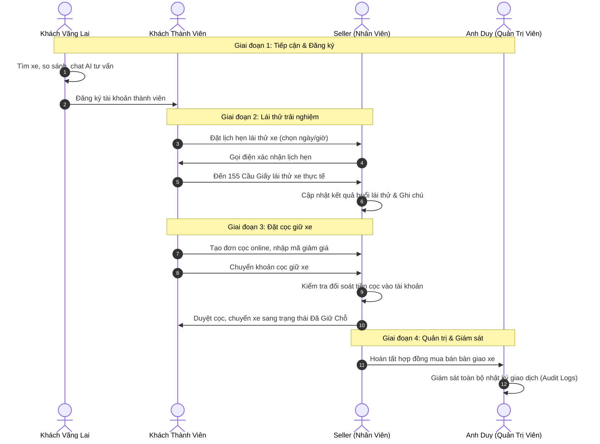

# Đặc Tả Các Tác Nhân & Người Dùng Hoạt Động Trong Website Showroom Ô Tô SkyCar

---

## 1. Tổng Quan Về Mô Hình Người Dùng Hoạt Động Trong Hệ Thống

Hệ thống **Website Showroom Ô Tô SkyCar** (155 Cầu Giấy, Hà Nội) được thiết kế phân định ranh giới chặt chẽ giữa 4 nhóm đối tượng tham gia hoạt động, đảm bảo tính bảo mật, phân quyền chuẩn hóa (Role-Based Access Control - RBAC) và phục vụ trọn vẹn quy trình kinh doanh xe thực tế:

1. **Khách Vãng Lai (Guest / Anonymous User):** Khách hàng chưa đăng ký hoặc chưa đăng nhập vào hệ thống.
2. **Khách Hàng Thành Viên (Registered Customer):** Khách hàng đã mở tài khoản và đăng nhập trên website.
3. **Nhân Viên Kinh Doanh (Seller):** Nhân sự phụ trách kho xe, điều phối lịch lái thử, duyệt cọc và chăm sóc khách hàng tại showroom.
4. **Quản Trị Viên (Anh Duy / Administrator):** Chủ sở hữu showroom, nắm toàn quyền điều hành, phân quyền nhân sự, kiểm soát tài chính và bảo mật hệ thống.

---

## 2. Chi Tiết Từng Nhóm Đối Tượng Hoạt Động Trong Web

---

### 2.1 Nhóm 1: Khách Vãng Lai (Guest)

* **Họ là ai?** Là những người lần đầu truy cập vào website của showroom để tham khảo thông tin, xem các mẫu xe đang bán hoặc kiểm tra bảng giá.
* **Không gian hoạt động:** Toàn bộ các trang công khai (Trang chủ, Danh mục xe, Chi tiết xe, So sánh xe, Định giá xe).
* **Những việc Khách Vãng Lai được làm:**
  * Xem danh sách các mẫu xe hiện có tại Showroom (Toyota, Mazda, Mercedes, v.v.).
  * Tìm kiếm xe thông thường (theo hãng, khoảng giá, số chỗ, kiểu dáng) hoặc tìm bằng câu nói tự nhiên qua trợ lý AI.
  * Xem hình ảnh thực tế đa góc nhìn, bảng thông số kỹ thuật chi tiết của từng chiếc xe.
  * Sử dụng công cụ đối chiếu, so sánh thông số giữa tối đa 3 mẫu xe cùng lúc.
  * Sử dụng công cụ định giá xe cũ đã qua sử dụng.
  * Trò chuyện tư vấn cùng Trợ lý ảo AI (được cấp một mã phiên tạm để ghi nhớ cuộc trò chuyện).
  * Điền biểu mẫu để lại số điện thoại và nhu cầu để nhận cuộc gọi tư vấn miễn phí từ showroom.
  * Tiến hành Đăng ký tài khoản thành viên hoặc Đăng nhập.
* **Những giới hạn của Khách Vãng Lai:**
  * *Không được* đặt lịch lái thử xe (hệ thống yêu cầu đăng nhập để đảm bảo uy tín và bảo hiểm khi lái thử).
  * *Không được* đặt cọc giữ xe trực tuyến.
  * *Không được* lưu danh sách xe yêu thích (Wishlist) vào tài khoản.
  * *Không được* viết đánh giá hoặc nhận xét về xe.
  * *Bị chặn tuyệt đối* khỏi khu vực quản trị nội bộ của nhân viên.

---

### 2.2 Nhóm 2: Khách Hàng Thành Viên (Customer)

* **Họ là ai?** Là những khách hàng đã có tài khoản trên website (thông qua đăng ký bằng Email và mật khẩu).
* **Không gian hoạt động:** Các trang công khai + Khu vực cá nhân khách hàng (`/profile`, `/bookings`, `/orders`, `/favorites`, `/notifications`).
* **Những việc Khách Hàng Thành Viên được làm:**
  * Kế thừa toàn bộ quyền hạn của Khách vãng lai.
  * **Quản lý hồ sơ cá nhân:** Cập nhật họ tên, số điện thoại, địa chỉ nhận xe, đổi mật khẩu.
  * **Lưu danh mục xe yêu thích:** Đánh dấu trái tim các mẫu xe ưng ý để theo dõi biến động giá.
  * **Đăng ký lịch hẹn lái thử xe:** Chủ động chọn mẫu xe, ngày, giờ và địa điểm lái thử (tại showroom 155 Cầu Giấy hoặc giao xe lái thử tận nhà).
  * **Chủ động hủy lịch lái thử:** Khách có quyền tự hủy lịch hẹn lái thử của mình nếu lịch đó vẫn đang ở giai đoạn chờ duyệt (`pending`).
  * **Đặt cọc giữ xe trực tuyến:** Tạo đơn cọc xe tại trang riêng, nhập mã ưu đãi giảm giá (voucher), xem thông tin tài khoản ngân hàng của showroom và hướng dẫn nộp tiền cọc.
  * **Theo dõi tiến độ đơn mua xe:** Xem lịch sử các đợt thanh toán cọc và tiến độ chuẩn bị xe.
  * **Gửi nhận xét & đánh giá xe:** Chấm điểm sao và viết cảm nhận trải nghiệm sau khi đã xem hoặc lái thử xe.
  * **Nhận thông báo tự động:** Nhận chuông thông báo trên website và email xác nhận ngay khi lịch lái thử hoặc đơn cọc được nhân viên xử lý.
* **Những giới hạn của Khách Hàng Thành Viên:**
  * Chỉ được xem và thao tác trên lịch hẹn và đơn hàng của chính mình (không xem được của khách khác).
  * *Bị chặn tuyệt đối* khỏi khu vực quản trị nội bộ của nhân viên và quản trị viên.

---

### 2.3 Nhóm 3: Nhân Viên Kinh Doanh (Seller)

* **Họ là ai?** Đội ngũ nhân viên bán xe của Showroom SkyCar. Trên giao diện được hiển thị danh xưng thống nhất là **Seller** (không để lộ tên riêng để bảo vệ quyền riêng tư cá nhân).
* **Không gian hoạt động:** Phân hệ quản trị nội bộ showroom (`/admin/*`).
* **Những việc Seller làm trên hệ thống:**
  * **Quản trị kho xe:** Thêm xe mới vào showroom, cập nhật giá bán, số km lăn bánh (ODO), chỉnh sửa thông số kỹ thuật và tải lên hình ảnh xe thực tế.
  * **Điều phối lịch hẹn lái thử:**
    * Tiếp nhận các yêu cầu lái thử từ khách hàng.
    * Gọi điện xác nhận và chuyển trạng thái lịch: *Đã xác nhận (Confirmed)* ➔ *Đã lái thử xong (Completed)* hoặc *Khách không đến (No-show)* / *Hủy lịch (Cancelled)*.
    * Ghi chú ý kiến đóng góp và nhu cầu thực tế của khách vào hồ sơ lịch hẹn.
  * **Quản lý đơn cọc giữ xe:**
    * Theo dõi các đơn đặt cọc mới phát sinh từ website.
    * Kiểm tra tiền cọc thực tế (chuyển khoản ngân hàng hoặc nộp tiền mặt tại 155 Cầu Giấy).
    * Bấm xác nhận thanh toán cọc và cập nhật tiến độ chuẩn bị hồ sơ bàn giao xe cho khách.
  * **Chăm sóc khách hàng tiềm năng (CRM Leads):**
    * Tiếp nhận danh sách số điện thoại khách để lại từ trang chủ hoặc chatbot AI.
    * Phân loại giai đoạn chăm sóc: *Mới* ➔ *Đã liên hệ* ➔ *Có tiềm năng* ➔ *Đang đàm phán giá* ➔ *Chốt thành công*.
  * **Kiểm duyệt đánh giá của khách:** Xem xét các bình luận đánh giá xe của khách hàng trước khi cấp phép hiển thị công khai trên website.
  * **Xem báo cáo cố vấn AI (AI Insights):** Tham khảo số liệu xu hướng thị hiếu khách hàng để biết dòng xe nào đang được quan tâm nhiều nhất.
* **Những giới hạn của Seller:**
  * *Không được* tạo, sửa hoặc phân quyền tài khoản người dùng khác.
  * *Không được* xóa vĩnh viễn xe ra khỏi hệ thống cơ sở dữ liệu.
  * *Không được* tự ý tạo hoặc sửa đổi mã giảm giá (voucher).
  * *Không được* xem nhật ký bảo mật của quản trị viên (Audit Logs).

---

### 2.4 Nhóm 4: Quản Trị Viên (Anh Duy)

* **Họ là ai?** Người quản trị cao nhất của hệ thống Showroom SkyCar, hiển thị tên chính thức là **Anh Duy** (Role: `admin`).
* **Không gian hoạt động:** Toàn quyền kiểm soát trên toàn bộ hệ thống từ trang ngoài đến toàn bộ phân hệ quản trị.
* **Những việc Quản Trị Viên Anh Duy thực hiện:**
  * **Bao gồm toàn bộ quyền hạn của Seller:** Có thể thực hiện mọi thao tác về kho xe, đơn cọc, lịch lái thử và chăm sóc khách hàng.
  * **Quản trị người dùng & Phân quyền:**
    * Xem toàn bộ danh sách tài khoản (Khách hàng, Seller, Admin).
    * Phân quyền cho nhân viên làm Seller hoặc nâng quyền Quản trị viên.
    * Khóa (`is_active = FALSE`) hoặc mở khóa các tài khoản vi phạm chính sách showroom.
  * **Kiểm soát danh mục sản phẩm đặc biệt:** Xóa vĩnh viễn thông tin xe khỏi kho dữ liệu hoặc tạm ẩn xe khi có sự cố.
  * **Quản lý chính sách ưu đãi & Voucher:** Phát hành các mã giảm giá cho showroom (ví dụ: Giảm 15 triệu, Giảm 50 triệu) và quy định mức đặt cọc tối thiểu.
  * **Giám sát nhật ký an toàn hệ thống (Audit Logs):**
    * Theo dõi mọi hành động sửa đổi giá xe, duyệt đơn cọc, thay đổi lịch hẹn của nhân viên.
    * Ghi nhận địa chỉ IP, thời gian thao tác và nội dung thay đổi để bảo đảm tính minh bạch, phòng ngừa gian lận.

---

## 3. Bảng Ma Trận Phân Quyền Giữa Các Nhóm Người Dùng

| Chức Năng Cụ Thể Trong Website | Khách Vãng Lai | Khách Thành Viên | Nhân Viên (Seller) | Quản Trị Viên (Anh Duy) |
| :--- | :---: | :---: | :---: | :---: |
| Xem danh mục & chi tiết xe |  Có |  Có |  Có |  Có |
| Tìm kiếm xe bằng ngôn ngữ tự nhiên / AI |  Có |  Có |  Có |  Có |
| So sánh thông số kỹ thuật xe |  Có |  Có |  Có |  Có |
| Trò chuyện cùng trợ lý ảo AI |  Có |  Có |  Có |  Có |
| Gửi form đăng ký tư vấn mua xe |  Có |  Có |  Có |  Có |
| Đăng ký / Đăng nhập tài khoản |  Có |  Đã có |  Đã có |  Đã có |
| Quản lý thông tin cá nhân & đổi mật khẩu | ❌ Không |  Có |  Có |  Có |
| Đặt lịch hẹn lái thử xe | ❌ Không |  **Có** | ❌ Không | ❌ Không |
| Tự hủy lịch lái thử (khi đang chờ duyệt) | ❌ Không |  **Có** | ❌ Không | ❌ Không |
| Đặt cọc giữ xe trực tuyến & nhập voucher | ❌ Không |  **Có** | ❌ Không | ❌ Không |
| Lưu danh sách xe yêu thích | ❌ Không |  **Có** | ❌ Không | ❌ Không |
| Gửi đánh giá, nhận xét về xe | ❌ Không |  **Có** | ❌ Không | ❌ Không |
| Thêm mới / Cập nhật thông tin xe | ❌ Không | ❌ Không |  **Có** |  **Có** |
| Xóa vĩnh viễn xe khỏi cơ sở dữ liệu | ❌ Không | ❌ Không | ❌ Không |  **Có** |
| Xác nhận / Đổi trạng thái lịch lái thử | ❌ Không | ❌ Không |  **Có** |  **Có** |
| Xác nhận thanh toán tiền cọc xe | ❌ Không | ❌ Không |  **Có** |  **Có** |
| Quản lý phễu khách hàng CRM Leads | ❌ Không | ❌ Không |  **Có** |  **Có** |
| Kiểm duyệt đánh giá xe của khách | ❌ Không | ❌ Không |  **Có** |  **Có** |
| Phân quyền & Khóa/Mở tài khoản người dùng | ❌ Không | ❌ Không | ❌ Không |  **Có** |
| Quản lý mã giảm giá (Voucher) | ❌ Không | ❌ Không | ❌ Không |  **Có** |
| Xem nhật ký an ninh & hoạt động (Audit Logs) | ❌ Không | ❌ Không | ❌ Không |  **Có** |

---

## 4. Sơ Đồ Tương Tác Phối Hợp Giữa Các Tác Nhân

Dưới đây là quy trình phối hợp nhịp nhàng giữa Khách hàng, Seller và Quản trị viên Anh Duy trong một chu trình mua xe thực tế tại Showroom SkyCar 155 Cầu Giấy:

---

## 5. Kết Luận

Mô hình phân định tác nhân trong Website Showroom Ô Tô SkyCar thể hiện tính chuyên nghiệp cao:
- **Tập trung vào khách hàng:** Giúp khách hàng dễ tiếp cận xe từ lúc là khách vãng lai cho đến khi trở thành khách hàng đặt cọc chính thức.
- **Tối ưu năng suất cho Seller:** Cung cấp đầy đủ công cụ để nhân viên quản lý kho xe, lái thử và đơn hàng nhanh chóng, không bị chồng chéo nhiệm vụ.
- **Quyền kiểm soát chặt chẽ cho Anh Duy:** Đảm bảo chủ showroom nắm trọn vẹn tình hình kinh doanh, dòng tiền cọc và kiểm soát tính minh bạch của toàn bộ nhân viên.
